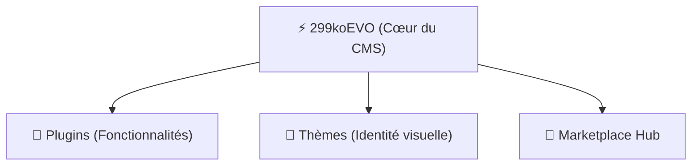

<div align="center">

# ⚡ 299koEVO

### Le CMS PHP moderne, ultra-léger et respectueux de la vie privée.
**Sans base de données obligatoire • Zéro télémétrie externe • Maîtrise totale de vos données.**

[](https://github.com/NemStudio18/299koEVO/releases)
[](https://www.php.net/)
[](LICENSE)
[](https://299ko.flexcb.fr)
[](#-stockage-flexible--choisissez-selon-vos-besoins)

[🇬🇧 Read in English](README.md) • [🌐 Site officiel & Démo](https://299ko.flexcb.fr/) • [💬 GitHub Discussions](https://github.com/NemStudio18/299koEVO/discussions) • [📦 Télécharger la dernière version](https://github.com/NemStudio18/299koEVO/releases)

---

</div>

## 💡 Pourquoi choisir 299koEVO ?

Face aux CMS traditionnels devenus des usines à gaz qui imposent des bases de données complexes, des dizaines de dépendances externes et des traqueurs publicitaires, **299koEVO** propose un retour à l'essentiel : **la performance brute, la simplicité et l'indépendance numérique**.

| Les CMS traditionnels | ⚡ L'expérience 299koEVO |
| :--- | :--- |
| ❌ Base de données MySQL obligatoire et lourde à administrer | ✅ **Prêt à l'emploi en JSON plat**. Déposez les fichiers et votre site tourne instantanément. |
| ❌ Requêtes lentes, temps de chargement > 1 à 2 secondes | ✅ **Temps de réponse inférieur à 50 ms**. Léger pour les serveurs et éco-conçu. |
| ❌ Dépendance aux géants du Web (Google reCAPTCHA, Google Fonts, CDN tiers) | ✅ **100% souverain**. Antispam cryptographique autonome, zéro pistage des visiteurs. |
| ❌ Mises à jour complexes avec risques de casser la base de données | ✅ **Marketplace intégrée**. Installez et mettez à jour vos modules en 1 clic. |

---

## 🚀 Fonctionnalités clés

- 🗄️ **Moteur multi-stockage agnostique** : Fonctionne nativement sur simples fichiers **JSON**, avec bascule transparente vers **SQLite** ou **MySQL / MariaDB** à tout moment.
- 🛡️ **Antispam souverain (`299nobot`)** : Protection des formulaires par challenge cryptographique serveur HMAC-SHA256, Preuve de Travail (PoW) navigateur, rate-limiting et honeypot. **Zéro reCAPTCHA, zéro cookie intrusif, 100% conforme RGPD**.
- 🧩 **Marketplace intégrée** : Catalogue officiel d'extensions accessible directement depuis l'administration pour installer thèmes et plugins en un clic.
- 🌗 **Mode Clair / Sombre universel** : Prise en charge native du Dark Mode dans l'ensemble de l'interface d'administration et des templates système.
- 🔒 **Sécurité renforcée nativement** : Protection CSRF stricte sur tous les formulaires, moteur d'évaluation des droits (`AccessPolicyEvaluator`), durcissement des sessions et désinfection HTML.
- ⚡ **Éco-conception & SEO optimisé** : Rendu serveur ultra-rapide, URLs canoniques propres avec redirection 301 automatique, génération native de sitemaps XML et flux RSS.

---

## 🗃️ Stockage flexible : Choisissez selon vos besoins

299koEVO utilise un système de modèles de données (`JsonActiveRecord`) qui abstrait la couche de persistance. Vous pouvez démarrer sans base de données et migrer plus tard selon l'évolution de votre trafic :

| Mode | Cas d'usage recommandé | Avantages majeurs |
| :--- | :--- | :--- |
| **📁 JSON (Défaut)** | Sites vitrines, blogs personnels, portfolios, documentations. | Zéro configuration. Déplacez ou sauvegardez votre site par un simple copier-coller de dossier. |
| **🪶 SQLite** | Sites associatifs, portails régionaux, commerces de taille moyenne. | Puissance du SQL dans un fichier unique, sans serveur de base de données à gérer. |
| **🐬 MySQL / MariaDB** | Fort trafic, plateformes communautaires, gros catalogues e-commerce. | Scalabilité maximale, requêtes concurrentes massives et hébergements distribués. |

---

## 🧩 L'écosystème 299koEVO

Le projet est articulé autour de 3 piliers complémentaires :

<div align="center">



</div>

### 1. [Le Cœur CMS (`NemStudio18/299koEVO`)](https://github.com/NemStudio18/299koEVO)
Le moteur d'exécution, le routeur AltoRouter, l'administration moderne, la gestion des utilisateurs et le système de cache.

### 2. [Le Catalogue des Plugins (`NemStudio18/Plugins_299koEVO`)](https://github.com/NemStudio18/Plugins_299koEVO)
Une bibliothèque modulaire d'extensions officielles prêtes à l'emploi :
- **🏷️ Petites Annonces (C2C)** : Plateforme communautaire avec formulaire de dépôt public, modération admin, multi-photos et messagerie directe acheteur/vendeur.
- **🛒 E-commerce (B2C)** : Boutique en ligne avec panier, gestion des stocks en temps réel, passerelle de paiement (Stripe, virement, chèque) et suivi colis.
- **💬 LiveChat** : Module de discussions en direct temps réel pour échanger avec vos visiteurs.
- **📝 Blog & Articles** : Publication d'articles avec catégories, pagination fluide, flux RSS et commentaires.
- **📊 LightStats** : Statistiques de fréquentation souveraines, auto-hébergées, sans cookies de pistage et conformes CNIL / RGPD.
- **🌦️ Météo & WeatherHeader** : Affichage des conditions météo en direct avec animations SVG dynamiques.
- **💌 Contact, Newsletter, Forum, Sondages, Galerie photos...**

### 3. [Le Catalogue des Thèmes (`NemStudio18/Skins_299koEVO`)](https://github.com/NemStudio18/Skins_299koEVO)
Des thèmes modernes, responsives et entièrement personnalisables pour adapter l'identité visuelle de votre site en un clic.

---

## 🛠️ Démarrage rapide (Installation en 3 étapes)

### Prérequis
- **PHP 8.1 ou supérieur** (recommandé : PHP 8.2+)
- Extensions PHP : `json`, `mbstring`, `gd` (ou `imagick`), `zip`, `pdo_sqlite` (recommandé)
- Serveur web : Apache (avec `mod_rewrite`, `.htaccess` inclus) ou Nginx

### Installation

1. **Téléchargez** la dernière version stable depuis la [page des Releases](https://github.com/NemStudio18/299koEVO/releases) (ou clonez ce dépôt) :
   ```bash
   git clone https://github.com/NemStudio18/299koEVO.git mon-site
   cd mon-site
   ```
2. **Déposez** les fichiers à la racine de votre hébergement web ou pointez votre VirtualHost vers ce dossier.
3. **Ouvrez** votre site dans votre navigateur : l'assistant visuel d'installation (`install.php`) vous guide en 30 secondes pour créer votre compte administrateur.

---

## 🤝 Participer & Rejoindre l'aventure

299koEVO est un projet libre et communautaire où chacun peut apporter sa pierre à l'édifice :

- 💬 **Discuter & poser une question** : Venez échanger sur [GitHub Discussions](https://github.com/NemStudio18/299koEVO/discussions).
- 🐛 **Signaler un bug** : Ouvrez une [Issue GitHub](https://github.com/NemStudio18/299koEVO/issues).
- 🔒 **Signaler une faille de sécurité** : Consultez notre politique de signalement privé dans [SECURITY.md](SECURITY.md).
- 💻 **Contribuer au code** : Consultez le guide de contribution dans [CONTRIBUTING.md](CONTRIBUTING.md).
- 🗺️ **Découvrir les prochaines nouveautés** : Consultez la feuille de route dans [ROADMAP.md](ROADMAP.md).

---

## 📄 Licence

299koEVO est un logiciel libre distribué sous licence **GNU General Public License v3.0 (GPLv3)**.  
Vous êtes libre de l'utiliser, le modifier et le redistribuer selon les termes de cette licence.
