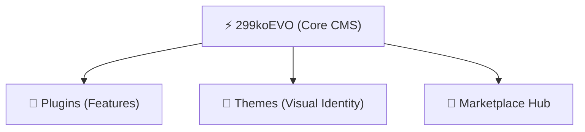

<div align="center">

# ⚡ 299koEVO

### The lightweight, modern, and privacy-first PHP CMS.
**No mandatory database • Zero third-party telemetry • Full data sovereignty.**

[](https://github.com/NemStudio18/299koEVO/releases)
[](https://www.php.net/)
[](LICENSE)
[](https://299ko.flexcb.fr)
[](#-flexible-storage--choose-what-fits-your-needs)

[🇫🇷 Lire en français](README.fr.md) • [🌐 Official Website & Demo](https://299ko.flexcb.fr/) • [💬 GitHub Discussions](https://github.com/NemStudio18/299koEVO/discussions) • [📦 Download Latest Release](https://github.com/NemStudio18/299koEVO/releases)

---

</div>

## 💡 Why choose 299koEVO?

Modern content management systems have turned into resource-heavy giants requiring complex databases, dozens of third-party dependencies, and embedded trackers. **299koEVO** brings web development back to essentials: **raw speed, simplicity, and digital independence**.

| Traditional CMS | ⚡ The 299koEVO Experience |
| :--- | :--- |
| ❌ Mandatory MySQL database requiring setup & maintenance | ✅ **Out-of-the-box flat-file JSON**. Just drop the files and your site is live immediately. |
| ❌ Slow queries, page load times > 1 to 2 seconds | ✅ **Blazing fast response times (< 50 ms)**. Eco-designed and ultra-lightweight on servers. |
| ❌ Heavy reliance on Big Tech (Google reCAPTCHA, Google Fonts, third-party CDNs) | ✅ **100% Sovereign**. Self-hosted cryptographic antispam, zero visitor tracking. |
| ❌ Complex updates with risks of breaking database schemas | ✅ **Built-in Marketplace Hub**. Install and update plugins and themes in 1 click. |

---

## 🚀 Key Features

- 🗄️ **Multi-Storage Engine**: Runs natively on simple **JSON** files, with seamless one-click switching to **SQLite** or **MySQL / MariaDB** whenever needed.
- 🛡️ **Sovereign Antispam (`299nobot`)**: Form protection powered by server HMAC-SHA256 tokens, browser Proof-of-Work (PoW), SQLite rate-limiting, and honeypot traps. **No reCAPTCHA, no cookies, 100% GDPR compliant**.
- 🧩 **Integrated Marketplace**: Access the official extension hub straight from the admin dashboard to install themes and plugins with one click.
- 🌗 **Universal Light & Dark Mode**: Native dark mode support across the entire administration interface, system templates, and ecosystem plugins.
- 🔒 **Hardened Security**: Strict CSRF tokens, fine-grained access policies (`AccessPolicyEvaluator`), secure session cookies, and HTML input sanitization.
- ⚡ **Eco-Friendly & SEO Optimized**: Fast server-side rendering, clean canonical URLs with automatic 301 redirects, native XML sitemaps, and RSS feeds.

---

## 🗃️ Flexible Storage: Choose What Fits Your Needs

299koEVO uses an abstraction layer (`JsonActiveRecord`) for all models. You can start with zero database configuration and scale up anytime:

| Storage Mode | Recommended Use Case | Main Advantages |
| :--- | :--- | :--- |
| **📁 JSON (Default)** | Showcase sites, personal blogs, portfolios, documentation. | Zero configuration. Backup or move your entire site with a simple folder copy. |
| **🪶 SQLite** | Community portals, non-profits, mid-sized stores. | The full power of SQL in a single local file, without managing a database daemon. |
| **🐬 MySQL / MariaDB** | High-traffic websites, large community platforms, big e-commerce catalogs. | Maximum scalability, high concurrency, and distributed multi-server hosting. |

---

## 🧩 The 299koEVO Ecosystem

The ecosystem is built around 3 complementary pillars:

<div align="center">



</div>

### 1. [Core CMS (`NemStudio18/299koEVO`)](https://github.com/NemStudio18/299koEVO)
The execution runtime, AltoRouter routing engine, modern administration UI, user and role management, and caching system.

### 2. [Official Plugins (`NemStudio18/Plugins_299koEVO`)](https://github.com/NemStudio18/Plugins_299koEVO)
A modular library of ready-to-use extensions:
- **🏷️ Classified Ads (`annonces` - C2C)**: Community classifieds platform with public submission, admin moderation, multi-photo WebP uploads, and direct buyer/seller contact.
- **🛒 E-commerce (`ecommerce` - B2C)**: Online store with cart, real-time inventory tracking, payment gateway (Stripe Checkout, bank transfer, check), and parcel tracking.
- **💬 LiveChat**: Real-time customer support chat module to engage directly with visitors.
- **📝 Blog & Articles**: Full-featured publishing with categories, tags, pagination, RSS feeds, and visitor comments.
- **📊 LightStats**: Privacy-first, sovereign analytics without tracking cookies (CNIL / GDPR compliant).
- **🌦️ Weather & WeatherHeader**: Live meteorological forecast widgets with dynamic SVG sky animations.
- **💌 Contact Forms, Newsletter, Forum, Polls, Photo Gallery...**

### 3. [Themes & Skins (`NemStudio18/Skins_299koEVO`)](https://github.com/NemStudio18/Skins_299koEVO)
Modern, responsive, and customizable skins to transform your website's visual appearance in seconds.

---

## 🛠️ Quick Start (3-Step Installation)

### Requirements
- **PHP 8.1 or higher** (recommended: PHP 8.2 / 8.3 / 8.4)
- PHP Extensions: `json`, `mbstring`, `gd` (or `imagick`), `zip`, `pdo_sqlite` (recommended)
- Web Server: Apache (`mod_rewrite` enabled, `.htaccess` included) or Nginx

### Installation

1. **Download** the latest release archive from the [Releases page](https://github.com/NemStudio18/299koEVO/releases) (or clone the repository):
   ```bash
   git clone https://github.com/NemStudio18/299koEVO.git my-website
   cd my-website
   ```
2. **Deploy** the files to your web server document root or point your VirtualHost to the directory.
3. **Open** your website in a browser: the guided web setup assistant (`install.php`) will configure your administrative account in under 30 seconds.

---

## 🤝 Get Involved & Community

299koEVO is an open-source project built for the community. We welcome all contributions:

- 💬 **Ask a question or share ideas**: Join the conversation on [GitHub Discussions](https://github.com/NemStudio18/299koEVO/discussions).
- 🐛 **Report a bug**: Open a [GitHub Issue](https://github.com/NemStudio18/299koEVO/issues).
- 🔒 **Security disclosure**: Review our private security policy in [SECURITY.md](SECURITY.md).
- 💻 **Contributing code**: Check out our contribution guide in [CONTRIBUTING.md](CONTRIBUTING.md).
- 🗺️ **Roadmap**: See upcoming features and goals in [ROADMAP.md](ROADMAP.md).

---

## 📄 License

299koEVO is free and open-source software licensed under the **GNU General Public License v3.0 (GPLv3)**.  
You are free to use, modify, and redistribute it under the terms of this license.
