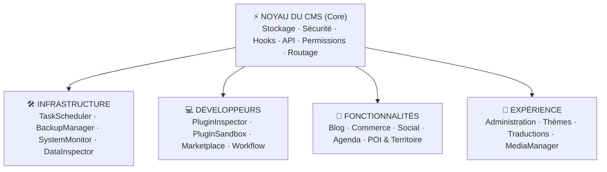

# Feuille de Route / Roadmap — 299koEVO

[🇫🇷 Français](#-feuille-de-route-2026---2027) • [🇬🇧 English](#-roadmap-2026---2027)

---

## 🇫🇷 Feuille de Route (2026 - 2027)

### 🧱 1. Le Socle Acquis du CMS (Ne pas réinventer ce qui existe)

| Composant | État & Rôle |
| :--- | :--- |
| **Multi-stockage JSON / SQLite / MySQL** | ✅ **Opérationnel** avec bascule transparente (`StorageManager`). |
| **`JsonActiveRecord`** | 🔄 **Actif**, à renforcer (transactions, verrous concurrents). |
| **Sécurité CSRF** | ✅ **Déployée à 100%** sur l'ensemble des formulaires et contrôleurs POST de l'écosystème. |
| **Antispam souverain (`299nobot`)** | ✅ **Opérationnel** (PoW navigateur, HMAC-SHA256, zéro reCAPTCHA). |
| **Politiques d'accès ABAC** | ✅ **Opérationnel** (`AccessPolicyEvaluator`, `ConditionContext`). |
| **Gestionnaire d'événements (`HookManager`)**| ✅ **Opérationnel** (`addHook`, `callHook`, `hooks.json`). |
| **Gestionnaire d'API (`ApiManager`)** | ✅ **Opérationnel** (`Core\Api\ApiManager`, routes API). |
| **Passerelle de Paiement centrale** | ✅ **Opérationnelle** (`PaymentDriverInterface`, hub central `paiement`). |
| **Marketplace Hub intégré** | ✅ **Opérationnel** (catalogue officiel et installation 1-clic). |
| **Mode Test & Bac à sable (`AdminTestMode`)** | ✅ **Opérationnel** (simulation en mémoire de session). |
| **Traductions & Localisation** | ✅ **Opérationnel** (fichiers `.ini` modulaires). |

---

### 🏛️ 2. L'Architecture Cible en 5 Piliers

---

### 🚀 3. Les Trois Chantiers Prioritaires

#### 1. `PluginInspector` (Priorité Haute) — Rendre l'écosystème intelligible
- [ ] Graphe des dépendances entre extensions.
- [ ] Détection des dépendances fantômes ou cassées.
- [ ] Vérification de la compatibilité des versions du Core requises.
- [ ] Détection des hooks non enregistrés et contrats non respectés.
- [ ] Analyse des routes, formulaires et conformité des permissions.
- [ ] Rapport de santé global avant toute installation ou mise à jour.

#### 2. `TaskScheduler` (Priorité Haute) — Autonomie d'exécution en arrière-plan
- [ ] Ordonnanceur natif pour tâches périodiques et exécutions différées.
- [ ] File d'attente persistante avec relance automatique après échec.
- [ ] Verrouillage anti-concurrence contre les exécutions simultanées.
- [ ] Historique et métriques d'exécution.
- [ ] Déblocage des capacités asynchrones pour `newsletter`, `LocalFeed`, `BackupManager` et `Workflow`.

#### 3. `DataInspector` (Priorité Haute) — Cohérence des données multi-moteurs
- [ ] Détection des entités orphelines et références croisées cassées.
- [ ] Nettoyage des doublons et validation des schémas JSON et SQLite.
- [ ] Comparateur d'intégrité entre les moteurs de stockage.

---

### 🎯 4. Modules d'Infrastructure & Évolutions Complémentaires

#### Infrastructure & Système
- [ ] **`SystemMonitor`** : Dashboard technique en temps réel (temps de réponse PHP, mémoire, temps des hooks, requêtes SQL).
- [ ] **`BackupManager` & `SiteExporter`** : Sauvegarde 1-clic et migration intégrale (code + data + médias) en ZIP sécurisé.
- [ ] **`MediaManager`** : Médiathèque transversale avec détection des fichiers inutilisés, conversion WebP et gestion des droits.

#### Outils Développeurs & Automatisation
- [ ] **`Workflow`** : Orchestrateur d'événements sans code (ex: *Article publié -> Notification Push -> RSS -> Post SocialFeed*).
- [ ] **`TranslationManager`** : Interface visuelle de comparaison multilingue avec détection des chaînes manquantes.
- [ ] **`PluginSandbox`** : Environnement de test éphémère pour exécuter un plugin sans impacter le site réel.

#### Évolutions des Extensions & Plugins
- [ ] **`Blog` (Gestion temporelle et éditoriale fine)** :
  - **Séparation des dates** : distinction claire entre date de création (`created_at`), date de parution/publication effective (`published_at`) et date de dernière modification (`updated_at`).
  - **Précision horaire** : passage du format jour simple (`Y-m-d`) à l'horodatage complet (`Y-m-d H:i:s`) avec heure et minute.
  - **Publication programmée / différée** : l'article reste masqué aux visiteurs jusqu'à ce que `published_at <= NOW()`.
  - **Affichage éditorial conditionnel** : mention publique *« Publié le [date] à [heure] »* et, en cas de révision ultérieure, *« Mis à jour le [date] à [heure] »*.

---

## 🇬🇧 Roadmap (2026 - 2027)

### 🧱 1. Established Foundation (Building Upon Existing Assets)

- **Multi-Storage Engine**: JSON flat-file, SQLite, MySQL/MariaDB ready.
- **CSRF Protection**: 100% enforced across all public and exclusive POST forms and controllers.
- **Sovereign Antispam (`299nobot`)**: Browser PoW + HMAC-SHA256 challenges active.
- **ABAC Engine**: `AccessPolicyEvaluator` and `ConditionContext` operational.
- **Core Event Bus**: `HookManager` and event hooks active.
- **Payment Hub**: Centralized `PaymentDriverInterface` abstraction.

### 🚀 2. Top Three Priority Pillars

1. **`PluginInspector` (High Priority)**: Extension static analysis, dependency graphs, orphan detection, and route/hook validation.
2. **`TaskScheduler` (High Priority)**: Background job queue, recurring tasks, concurrency locks, and retry mechanism.
3. **`DataInspector` (High Priority)**: Cross-storage consistency checks, broken reference detection, and data health verification.

### 🎯 3. Next Milestones

- **`SystemMonitor`**: Technical telemetry dashboard (PHP timing, memory, hook execution speed).
- **`BackupManager` & `SiteExporter`**: 1-click snapshot export and seamless migration between servers.
- **`MediaManager`**: Centralized asset library with orphan detection and WebP processing.
- **`Workflow`**: Inter-plugin event orchestrator.
- **`TranslationManager`**: Graphical dictionary diff and missing keys detector.
- **`Blog` (Advanced Editorial Scheduling & Timestamps)**: Distinct creation date (`created_at`), scheduled publication date (`published_at`), and revision date (`updated_at`) with full hour/minute precision (`Y-m-d H:i:s`), plus conditional "Updated on..." display.
